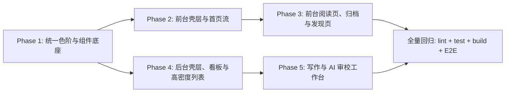

# Inkforge 前后端 UI 改造实施计划（功能零变更）

> **基线分支**：`origin/main`（`2e1b657`）→ 改造分支 `feat/fuwari-ui-redesign`
> **视觉定稿**：同目录交互设计稿 `01-public-blog-ui.html`、`02-admin-operations-ui.html`、`03-admin-editor-workspace-ui.html`
> **核心原则**：**只改视觉层、信息密度与响应式交互体验，100% 保留现有路由、API 契约、数据结构、鉴权、缓存失效与业务交互逻辑。**

---

## 一、功能不变性红线（Functional Invariants）

在全部改造阶段中，以下边界严格锁定、不做破坏性变更：

1. **后端与数据层零改动**
   - 不修改 `prisma/schema.prisma`、`prisma/migrations/`、`middleware.ts`、`src/app/api/**`。
   - 不修改 `src/lib/**` 下的业务逻辑、鉴权（`requireSession` / `requireAdminSession`）、内部密钥网关、ISR 缓存时间（`PUBLIC_REVALIDATE_SECONDS = 300`）与 `revalidate*` 路径失效策略。
2. **路由、URL 参数与本地持久化键零改动**
   - 前台全部 URL、查询参数（`?q=`、`?page=`、`?category=`、`?tag=`、`?sort=`）、SEO `generateMetadata`、`JsonLd`、`/rss.xml`、`/llms.txt`、`/opengraph-image` 保持原样。
   - 认证与重定向契约保持原样：`GlobalLoginDialog` 401 拦截（`handleGlobalSwrError`）、`/register`、`/auth/redirect`、`/profile` 与 `/profile/edit` 重定向至 `/admin`。
   - `localStorage` 键名与格式保持兼容：`theme`、`hue`（动态色相）、`vben_admin_tabs`、`author:draft:new`、`author:draft:edit:*` 以及 `useFilterMemory` 各列表筛选记忆键。
3. **SWR 取数、表单校验与状态编排保持原样**
   - 客户端继续统一使用 `useSWR` + `apiFetcher` / `apiMutate`，保留现有乐观更新、轮询（AI 任务/批量摘要）与确认弹窗逻辑（发布确认、超过 5 篇批量发布二次提醒、删除影响确认）。
4. **架构与测试契约守护**
   - 严格遵守 `admin-panel-boundary-contract.test.ts`（`AdminSettingsClient.tsx` 与 `admin/ai-news/page.tsx` 只做装配，不内联 `WorkspacePanel` / `FormField` / `StatusBadge`）。
   - 严格遵守 `admin-post-workspace-layout-contract.test.tsx`（`AdminPostWorkspace.tsx` 保持薄编排，`PublishSettingsPanel` 与 `MetadataEditor` 职责边界不变）。
   - 严格遵守 `dark-mode-contract.test.tsx` 与 `blogt3-theme-foundation.test.tsx`（保留语义化 CSS 变量、`.card-base` / `.reader-*` / `.admin-theme` 类名契约、代码块语义色、无障碍焦点环与细滚动条）。

---

## 二、分阶段改造路线（共 5 个阶段）

采用 **“共享设计底座 → 前台壳层与首页 → 前台阅读与发现页 → 后台壳层与运营页 → 沉浸式写作工作台”** 的自底向上推进方式，每个阶段均可独立跑通对应单测与类型检查，避免大爆炸式改动。

---

### Phase 1：统一前后端 OKLCH 色阶与温润无硬框组件底座

**目标**：消除前台硬朗灰框嵌套感，并解决后台切入 `#f0f2f5` / `#141414` 冷硬黑白灰的视觉割裂，让前后端共享同一套随 `--hue` 联动的高质感色阶。

| 涉及文件 | 改造内容（功能不变） | 关联契约/验证 |
| :--- | :--- | :--- |
| `src/styles/theme-variables.css` | 1. 校准 `:root` 与 `:root.dark` 的 `--page-bg`、`--card-bg`、`--reader-panel`、`--reader-border`（弱化硬边框至 4%–6% 透明度，依靠温润明度差建立层次）； 2. 重构 `.admin-theme` 与 `.dark .admin-theme`：将原本死板的 `#f0f2f5` / `#141414` 替换为带极微弱 `--hue` 倾向的温润中性色阶，将 `--admin-sidebar-active-bg` 调整为柔和胶囊底色，保留全部既有变量名。 | `dark-mode-contract.test.tsx` `theme-tokens.test.tsx` |
| `src/styles/components.css` | 1. 收敛 `.card-base`、`.reader-panel`、`.reader-card`、`.reader-feed-card`、`.reader-feature-card` 的圆角比例（`1rem–1.125rem`）与柔和漫射阴影，去除生硬悬浮发光与粗线条； 2. 优化 `.reader-nav` 半透悬浮质感、`.reader-section-heading` 左侧 `3.5×14px` 主题色短竖条与 `.reader-card-action` 右侧进入导轨样式。 | `blogt3-theme-foundation.test.tsx` `dark-mode-contract.test.tsx` |
| `src/app/globals.css` | 校准首页与内页顶部夜读横幅（`fuwari-night-city-bg.svg`）渐隐过渡高度与主网格上浮间距（`--reader-page-top`），保留 `theme-init`、4px 细滚动条与侧栏隐藏滚动条规则。 | `dark-mode-contract.test.tsx` |
| `src/components/ui/{Card,Button,Input,HuePicker}.tsx` | 对齐 Fuwari 柔和胶囊按钮（`--btn-regular-bg` / `--btn-content`）与干净表单输入态，保留 `HuePicker` `0–360` 色相实时调节与持久化。 | `primitives.test.tsx` `hue-picker.test.tsx` |

---

### Phase 2：前台公共壳层与首页（Fuwari × Shiro 去 AI 化重构）

**目标**：对照 `01-public-blog-ui.html` 视图 1，收起巨幅营销海报感，还原独立博客的“横幅叠入 + 个人温度 + 早读便签 + 右侧内嵌缩略图文章流”。

| 涉及文件 | 改造内容（功能不变） | 关联契约/验证 |
| :--- | :--- | :--- |
| `src/components/layout/AppShell.tsx` `src/components/layout/Navbar.tsx` `src/components/layout/Footer.tsx` | 1. `Navbar`：保持滚动显隐（`useScrollHide`）、站内搜索、`HuePicker`、日夜切换、账号入口与移动端菜单功能不变；优化为更轻盈的 Fuwari 半透悬浮顶栏与柔和激活态底色； 2. `AppShell`：优化横幅与双栏主视图的上浮叠入比例，窄屏（`<1280px`）保持单列高可读性； 3. `Footer`：收敛为干净单层底栏，保留导航链接与 `/rss.xml` 订阅入口。 | `app-shell.test.tsx` `navbar-behavior.test.tsx` `public-chrome.test.tsx` |
| `src/components/layout/Sidebar.tsx` `src/components/blog/PopularPostsWidget.tsx` | 1. 作者资料卡改为 Fuwari 经典圆角矩形头像（`16px`）+ 姓名下方 `20×4px` 主题色短横条 + 简介 + 社交图标； 2. `分类`、`标签`、`热门文章` 与已登录用户的 `阅读统计` / `本月阅读目标` 全部保留 SWR 数据源，统一为左侧短竖条标题 + 柔和计数角标，去掉虚线框与杂乱彩点。 | `public-chrome.test.tsx` `sidebar-api.test.tsx` `PopularPostsWidget.test.tsx` |
| `src/app/(public)/page.tsx` `src/components/blog/HomeEditorialHero.tsx` | 保留首页并发取数、错误降级 `role="alert"`、唯一 `<h1>`（站点名）、`data-testid="home-editorial-hero"` 与 `阅读精选` 链接；将原本高达 `22rem` 的巨型海报框收紧为温润紧凑的 **“博主问候 + 置顶精选导读卡”**（窄屏补齐个人身份感，桌面端右侧内嵌圆角封面）。 | `home-reader-flow.test.tsx` `public-layout-cache.test.ts` |
| `src/components/blog/HomeAiDailyStrip.tsx` | 保留 `AI 日报` 标题与 `/series/ai-daily` `查看全部` 入口；将拥挤的 5 列横滑卡片重构为 Shiro 风格的 **“早读便签 · AI 日报”** 轻量日期切换/直达条，彻底去掉 AI 资讯门户味。 | `HomeAiDailyStrip.test.tsx` `home-reader-flow.test.tsx` |
| `src/components/blog/PostCard.tsx` `src/components/blog/PostMeta.tsx` `src/components/blog/HomeLatestPosts.tsx` `src/components/posts/PostCard.tsx` | 1. 对齐 Fuwari `PostCard`：有封面文章采用 **`[左侧标题/元信息/双行摘要/统计 | 右侧内嵌圆角缩略图]`** 布局；无封面随笔去掉刻板的“夜读札记”英文大写横线，改为 **`[左侧正文 | 右侧柔和色阶竖向进入条 ›]`**； 2. `PostMeta` 使用 `/` 标签分隔与等宽数字，保留精选标识、评论/点赞/阅读计数与 View Transition 锚点； 3. 同步更新 `frontend-listing-style.test.tsx` 中仅针对旧版左图右文列序的样式断言，确保业务断言全部保留。 | `PostCard.test.tsx` `HomeLatestPosts.test.tsx` `frontend-listing-style.test.tsx` |

---

### Phase 3：前台文章阅读页、时间线归档与全站发现页

**目标**：对照 `01-public-blog-ui.html` 视图 2 & 3，把阅读页、归档页及分类/系列/搜索/认证页统一到干净克制的单层卡片体系。

| 涉及文件 | 改造内容（功能不变） | 关联契约/验证 |
| :--- | :--- | :--- |
| `src/app/(public)/posts/[slug]/page.tsx` `src/components/blog/{ArticleHero,ArticleContinuation,ArticleRelatedPosts,ArticleToc,ArticleTocRail,ArticleTocDrawer,SeriesNav,NewsletterForm}.tsx` `src/components/{CommentAuthGate,CommentForm}.tsx` | 1. 阅读主卡片去掉多层画框套娃：采用干净元信息行 + 标题 + 温和浅底提要便签（`excerpt`）+ 正文 `#` 主题色章节锚点； 2. 保持 `prose-pre:bg-[var(--surface-elevated)]`、`CopyCodeButton`、`ReadingProgress`、`ArticleReadTracker`、`LikeButton`、`BookmarkButton`、`ShareButton`、`SeriesNav` 全部交互不变； 3. 上下篇跳转（`ArticleContinuation`）改为 Fuwari 双卡并排样式；评论区与邮件订阅去除重边框嵌套；右侧 `ArticleToc` 保持现有缩进与激活态契约。 | `article-blogt3-style.test.tsx` `article-dark-markdown-contract.test.tsx` `article-experience.test.tsx` `article-metadata.test.tsx` `CommentForm.test.tsx` |
| `src/app/(public)/archives/page.tsx` | 对照设计稿视图 3，将原本按文章逐张堆砌的大卡片重构为 **Fuwari 单卡片虚线年份时间线**（`YYYY` + 主题色空心圆环 + 篇数统计 + `MM-DD · 虚线节点 · 标题 · 分类` 紧凑行，行节点保留 `.reader-feed-card` 兼容类名）。 | `archives-page.test.tsx` |
| `src/components/taxonomy/{TaxonomyHero,TaxonomyDirectoryCard,TaxonomyPostGrid}.tsx` `src/app/(public)/{posts,categories,tags,series,guides,search,bookmarks,about,contact}/**` `src/components/auth/{LoginForm,GlobalLoginDialog}.tsx` `src/app/(auth)/register/page.tsx` | 1. 收紧列表页顶部 `TaxonomyHero`（保留 `.reader-banner` 契约但降低高度与口号感，突出标题与筛选）； 2. 统一 `SeriesCard`、`SearchResultCard`、`BookmarksPageClient`、`ContactForm`、`about` 页面卡片圆角与留白； 3. 登录弹层与注册页继续保持语义化 Token（禁用手写 `gray-*`/`blue-*`），升级为温润无压迫感表单卡片。 | `posts-page-seo.test.tsx` `series/page.test.tsx` `guides-page.test.tsx` `search/page.test.tsx` `bookmarks/page.test.tsx` `ContactForm.test.tsx` `LoginForm.test.tsx` |

---

### Phase 4：后台壳层、运营概览与高密度管理页（对照 `02-admin-operations-ui.html`）

**目标**：让后台与前台同源温润色阶，补齐 `<1024px` 移动端抽屉导航，砍掉 `/admin/posts` 占据半屏的 5 张彩色大指标卡，把纵向空间还给高频内容队列。

| 涉及文件 | 改造内容（功能不变） | 关联契约/验证 |
| :--- | :--- | :--- |
| `src/components/admin/shell/{AdminLayout,AdminSider,AdminHeader,AdminTabsBar}.tsx` | 1. **保留全部既有桌面端布局契约**：`data-testid`（`admin-layout-grid`/`sidebar`/`content`/`main`）、`224px/64px` 折叠宽度、固定高度路由锁滚（`/admin/posts`、编辑器、`/admin/logs`）、`AI 助手` `
` 折叠组、底部账号下拉菜单、`AdminGlobalSearch` 与 `NotificationBell`； 2. **视觉升级**：侧栏去除刺眼实心亮蓝激活块与大写英文噪音，改用柔和主题色胶囊激活态；`AdminHeader` 与 `AdminTabsBar` 降噪减薄； 3. **新增窄屏抽屉菜单（`<1024px`）**：在 `AdminHeader` 窄屏下提供抽屉式侧栏入口，解决原本窄屏无导航死胡同。 | `admin-layout.test.tsx` `AdminBreadcrumbs.test.tsx` `NotificationBell.test.tsx` |
| `src/components/admin/primitives/{PageHeader,WorkspacePanel,Toolbar,StatusBadge,AdminPagination}.tsx` `src/components/admin/{DataTable,FilterBar}.tsx` | 统一后台通用原语：圆角收紧至 `8px–13px`，弱化多重嵌套边线，表格行高与表头字重调优，所有行级操作按钮统一加 `whitespace-nowrap shrink-0` 防止窄列折行。 | `DataTable.test.tsx` `AdminPagination.test.tsx` |
| `src/app/admin/page.tsx` `src/app/admin/AdminAnalyticsCharts.tsx` `src/components/admin/dashboard/AdminTodoStrip.tsx` | 1. 保留 `今日待办`、`内容健康指标`（7 日发布数/阅读时长/互动率/订阅净增）、`访问趋势`、`阅读统计`、`互动统计`、`最近草稿`、`待审评论`、`热门文章` 全部数据块与链接契约； 2. 去除花哨图标背景盒，升级为等宽数字指标带、低噪折线面积图与紧凑待办双栏。 | `src/app/admin/__tests__/page.test.tsx` `AdminTodoStrip.test.tsx` |
| `src/app/admin/posts/page.tsx` `src/components/admin/posts/{PostsTable,posts-ui}.tsx` | 1. **高密度空间释放**：将原本占去半屏高度的 5 张彩色大号 `MetricCard` 压缩为紧凑单行统计/快筛条，完整保留 `AI 内容队列`、`{total} 篇内容`、`新建文章`、`全部内容 / 仅看草稿 / 已发布 / 非 AI 日报`、搜索框、勾选批量操作栏（`AI 批量补全 / 批量发布 / 批量转草稿 / 批量删除`）及全部确认弹窗； 2. 优化 `PostsTable` 标题/Slug 双行排版、圆点状态标识与右侧紧凑动作区。 | `admin-density.test.tsx` `posts-workbench.test.tsx` `PostsTable.publish-toggle.test.tsx` |
| `src/components/admin/ai-news/*.tsx` `src/components/admin/{ai,comments,covers,logs,newsletter,notifications,settings,taxonomy}/**` `src/app/admin/{comments,covers,logs,newsletter,notifications,series,topic-guides,ai}/**` | 在严格保持 `AdminSettingsClient.tsx` 与 `admin/ai-news/page.tsx` 薄装配边界的前提下，统一 `AiNewsRun*Panel` / `AiNewsSource*`、评论审核、分类标签工作室、封面库、AI 任务/模型、日志与系统设置各子面板的卡片留白、筛选栏与按钮层次。 | `admin-panel-boundary-contract.test.ts` `ai-news-page.test.tsx` `comments-page.test.tsx` `taxonomy-studio.test.tsx` `covers-page.test.tsx` `logs-page.test.tsx` `settings-page.test.tsx` |

---

### Phase 5：沉浸式写作与 AI 协同审校工作台（对照 `03-admin-editor-workspace-ui.html`）

**目标**：让写作者拥有无干扰的书写体验、与前台完全同源的实时 Markdown 预览，以及温和不越俎代庖的字段级 AI 审校辅助。

| 涉及文件 | 改造内容（功能不变） | 关联契约/验证 |
| :--- | :--- | :--- |
| `src/components/posts/WorkspaceHeader.tsx` | 重构为无干扰轻量写作顶栏：左侧返回入口 + 自动保存状态圆点提示，右侧主次分明的 `保存草稿 / 定时发布 / 发布文章（或更新发布）` 与 AI 工作台入口，保持提交 `intent` 机制与发布确认弹窗不变。 | `admin-editor.test.tsx` `editor-publish-flow.test.tsx` |
| `src/components/posts/EditorWorkspace.tsx` `src/components/posts/MarkdownEditor.tsx` | 1. 保留标题输入、粘贴/拖拽上传图片、`useDeferredValue` 防卡顿实时渲染与 `分屏 / 编辑 / 预览` 切换； 2. 优化轻量格式工具栏，预览窗严格复用前台 Fuwari 正文排版（`#` 主题色二级标题、行高 `1.75`、语义化代码块 `prose-pre:bg-[var(--surface-elevated)]`），做到真正所见即所得。 | `markdown-editor.test.tsx` `editor-workspace-summary.test.tsx` `dark-mode-contract.test.tsx` |
| `src/components/posts/AdminPostWorkspace.tsx` `src/components/posts/{PublishSettingsPanel,MetadataEditor,PublishChecklist,AiFieldButton,ArticleInfoPreviewModal}.tsx` `src/components/admin/ai/PostAiWorkspace.tsx` | 1. 保持 `AdminPostWorkspace` 状态编排与 `WorkspacePanel` `fillHeight={false}` 布局契约不变，保持 `PublishSettingsPanel` 内 `精选状态` 与窄屏单列按钮网格契约不变； 2. 将右侧发布设置、分类标签封面选择、AI 字段生成建议与 `PublishChecklist`（含 AI 审校结果）整理为清爽紧凑的侧边检查器卡片，支持一键生成与人工微调回填； 3. 同步检查 `/write` 与 `/posts/[slug]/edit` 创作入口样式一致性。 | `admin-post-workspace-layout-contract.test.tsx` `PublishChecklist.test.tsx` `publish-checklist-ai-review.test.tsx` `admin-create-post.test.tsx` `author-workflow.test.tsx` |

---

## 三、质量门禁与验收标准（Verification Plan）

每完成一个阶段执行局部快速验证，全部 5 个阶段完成后执行全量门禁：

1. **阶段性单测回归**
   - Phase 1：`pnpm vitest run src/components/ui/__tests__ src/components/__tests__/dark-mode-contract.test.tsx`
   - Phase 2：`pnpm vitest run src/app/__tests__/home-reader-flow.test.tsx src/app/__tests__/frontend-listing-style.test.tsx src/components/layout/__tests__ src/components/blog/__tests__`
   - Phase 3：`pnpm vitest run src/app/__tests__/archives-page.test.tsx src/app/posts/[slug]/__tests__ src/app/(public) src/components/auth/__tests__`
   - Phase 4：`pnpm vitest run src/components/admin src/app/admin/__tests__`
   - Phase 5：`pnpm vitest run src/components/posts/__tests__ src/app/write/__tests__ src/app/posts/[slug]/edit/__tests__`
2. **全量静态检查与单测**
   - `pnpm lint`（0 warning / 0 error，遵守 React Hooks 渲染期与 Effect 规则）
   - `pnpm test`（全仓库 Vitest 单测与契约测试全绿）
3. **生产构建与缓存契约验证**
   - `pnpm build`（验证 Next.js 16 App Router SSR / ISR 构建、TypeScript 类型与静态参数生成无误）
4. **视觉与交互走查**
   - 检查日间/夜间双模式、`0–360` 动态色相联动、桌面端（`1440px` / `1080px`）与移动端（`390px`）无横向溢出、无按钮文字折行、无多重硬框嵌套与 AI 营销腔文案残留。
